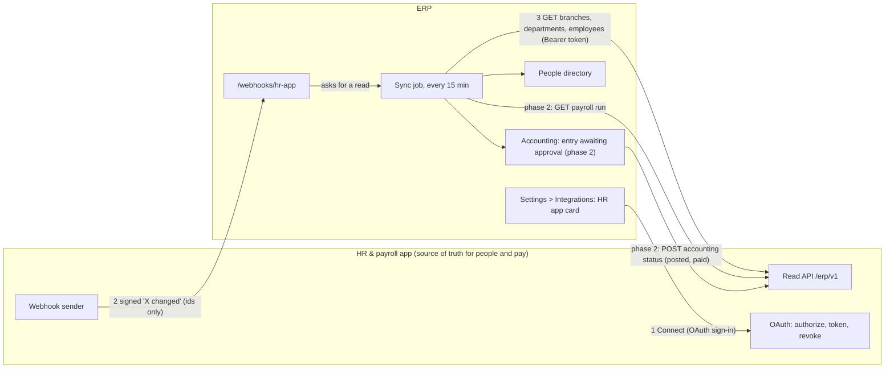
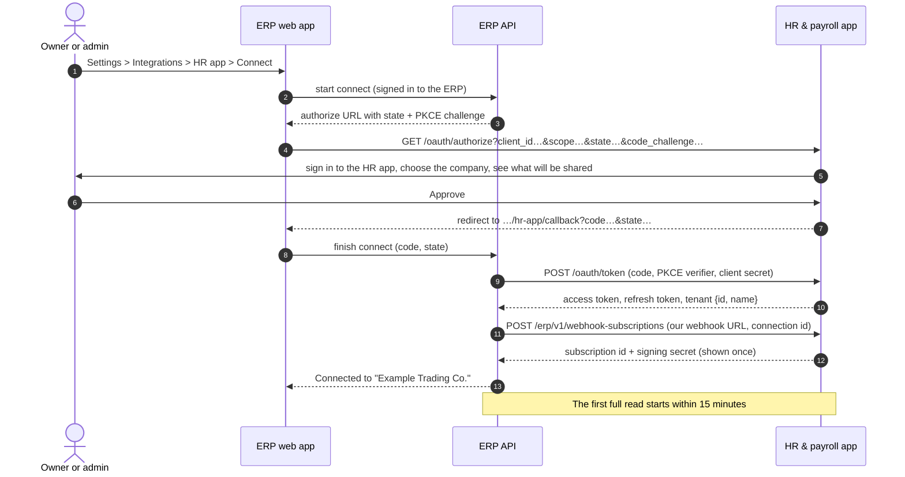
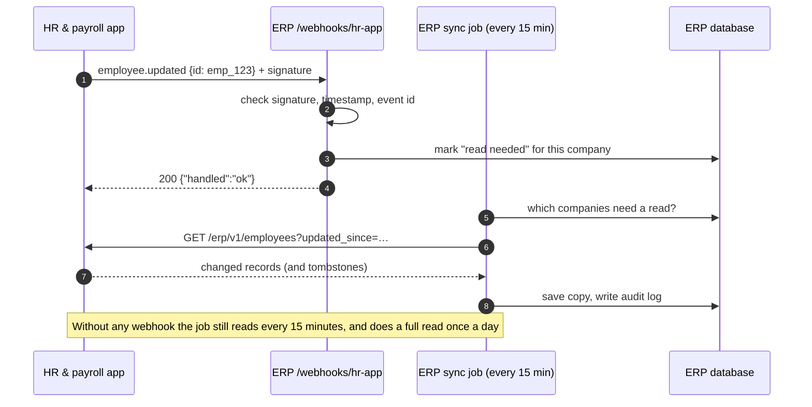
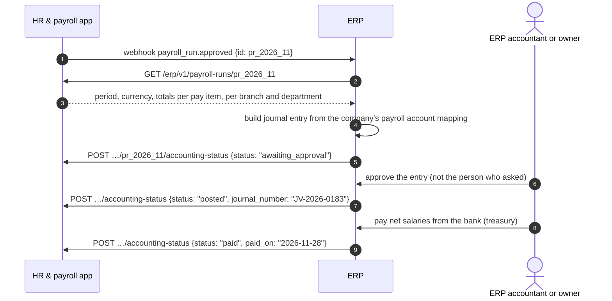

# HR & payroll app ↔ ERP integration contract, v1

**Status:** v1 draft for the HR app team, 20 Nov 2026. Our side is planned in
[HR_APP_INTEGRATION_PLAN.md](../plans/HR_APP_INTEGRATION_PLAN.md) and not built yet. Until both sides ship, changes are agreed
together; after that, v1 only grows by additions (section 10). A machine-readable copy (OpenAPI 3.1) is in
[hr-app-integration-openapi.yaml](hr-app-integration-openapi.yaml).

**In one paragraph.** A customer who uses both products clicks **Connect HR app** in the ERP, signs in to the HR app, approves,
and is done: no keys to copy (OAuth 2.0, section 3). From then on the ERP **reads** people data from the HR app's API, and the HR
app **notifies** the ERP with signed webhooks when something changes. Phase 1 is "who works where": branches, departments,
employees. Phase 2 is payroll: an approved payroll run becomes an accounting entry in the ERP, waiting for the ERP's own approval,
and the ERP tells the HR app when it is posted and paid.

---

## 1. About the ERP (what you are connecting to)

- **What it is.** A multi-tenant, cloud ERP for small and medium companies, Egypt first: inventory, purchasing, sales, finance,
  accounting (Egyptian unified chart of accounts, VAT, ETA e-invoicing), treasury (cash and bank), owner dashboards. Arabic and
  English everywhere. Sold to many companies at once, so every request is about exactly one company.
- **Company (organization).** One customer company. All data belongs to one company and can never be seen by another. **One ERP
  company connects to exactly one HR app tenant**, and the other way round.
- **Members.** People who sign in to the ERP, each with a role: `owner`, `admin` or `member` (plus finer permissions). Most
  employees are *not* ERP members; the ERP links an employee to a member only when they are the same person.
- **Branches.** The ERP has its own branches (used for stock, documents and tax). An HR branch is mapped to an ERP branch once by a
  person; we do not merge them automatically.
- **Approvals are real.** Anything that changes stock or the books is approved inside the ERP, by someone other than the person
  who asked, and every change is written to an append-only audit log. That is why, in phase 2, an approved payroll in the HR app
  arrives in the ERP as an entry **waiting for approval**, never as a posted one.
- **Money** is always an integer in minor units plus an ISO 4217 code (`{"amount_minor": 125050, "currency": "EGP"}` = EGP
  1,250.50). Never floats. Default currency is EGP but each company sets its own.
- **Time** is UTC, ISO 8601 with `Z`.

## 2. How the two apps talk (overview)



Three rules make it robust:

1. **The HR app is the source of truth** for people and pay. The ERP keeps a read-only copy and never edits it.
2. **Webhooks carry ids, not data.** A webhook only says "employee emp_123 changed"; the ERP then reads the record from the API. A
   lost or late webhook only delays an update until the next 15-minute read.
3. **Money only moves in the ERP after the ERP's own approval.**

### 2.1 What each side exposes to the other

| From | To | What | When | Phase |
|---|---|---|---|---|
| HR app | ERP | Tenant id and name | at Connect | 1 |
| HR app | ERP | Branches: id, code, name (EN/AR), active | read API | 1 |
| HR app | ERP | Departments: id, code, name, branch, parent | read API | 1 |
| HR app | ERP | Employees: id, number, name (EN/AR), **work** email, job title, branch, department, manager, status, hire/leave date | read API | 1 |
| HR app | ERP | "Something changed" events (ids only) | webhook | 1 |
| HR app | ERP | Payroll run totals per pay item and per branch/department; advances; expense claims | read API | 2 |
| ERP | HR app | Its webhook address and a connection id | at Connect | 1 |
| ERP | HR app | Accounting status of a payroll run, advance or claim: posted (journal number, date), paid (date), rejected (reason) | write API | 2 |

**Never exchanged:** passwords or sign-ins of either app; salaries of individual employees (the ERP needs totals only); national
ID, passport, phone, home address, birth date, gender, religion, health, bank details, photos, documents. The ERP drops any field
it does not know.

## 3. Connecting: OAuth 2.0 (one click for the customer)

The ERP is registered **once** as an OAuth client of the HR app (not once per customer). The HR app team gives us a `client_id`
and `client_secret` and registers our redirect address:
`https://<erp-web-host>/settings/integrations/hr-app/callback` (production and one staging address).

Standard used: OAuth 2.0 authorization code grant with **PKCE (S256)** (RFC 6749, RFC 7636), refresh tokens with rotation,
token revocation (RFC 7009), and preferably metadata discovery at `/.well-known/oauth-authorization-server` (RFC 8414).



### 3.1 `GET {issuer}/oauth/authorize`

| Parameter | Value |
|---|---|
| `response_type` | `code` |
| `client_id` | the ERP's client id |
| `redirect_uri` | exactly as registered |
| `scope` | space separated; v1: `erp.people.read offline_access`; phase 2 adds `erp.payroll.read erp.payroll.status.write` |
| `state` | opaque, ≥ 32 characters; return it unchanged |
| `code_challenge`, `code_challenge_method` | PKCE, `S256` only |

Your screen: sign in (your own sign-in, MFA, etc.), choose the tenant if the person belongs to several, show in plain words what
the ERP will be able to read (section 2.1), Approve / Cancel. **Only an admin of that HR tenant may approve.** On approval redirect
to `redirect_uri?code=…&state=…`; on cancel or error `redirect_uri?error=access_denied&state=…` (standard OAuth error codes). The
code is single-use and expires within 60 seconds.

### 3.2 `POST {issuer}/oauth/token`

Client authentication: HTTP Basic with `client_id:client_secret` (`client_secret_basic`). Body `application/x-www-form-urlencoded`.

Exchange the code:

```
grant_type=authorization_code&code=…&redirect_uri=…&code_verifier=…
```

Refresh:

```
grant_type=refresh_token&refresh_token=…
```

Response:

```json
{
  "access_token": "hrat_9mJ2…",
  "token_type": "Bearer",
  "expires_in": 3600,
  "refresh_token": "hrrt_Qe71…",
  "scope": "erp.people.read offline_access",
  "tenant": { "id": "ten_7Kd9", "name": "Example Trading Co." }
}
```

- Access tokens last at most 1 hour. **Refresh tokens rotate**: each refresh returns a new one; accept the previous one for 60
  seconds (two ERP workers may refresh at once), then reject it. A refresh token without use for 90 days may expire.
- A token belongs to one tenant and one connection; it must never read another tenant's data.
- Errors use the OAuth format: `{"error": "invalid_grant", "error_description": "…"}`.

### 3.3 `POST {issuer}/oauth/revoke`

RFC 7009, same client authentication, `token=<refresh token>`. Revokes the whole connection (its access tokens too). The ERP calls
it when the customer clicks **Disconnect** in the ERP.

### 3.4 Disconnecting from the HR app's side

If the HR tenant admin disconnects the ERP in your app: revoke the tokens, send the signed `connection.revoked` webhook (section 6),
then delete the webhook subscription. The ERP shows "Disconnected in the HR app" and keeps the read-only copy, marked stale.

### 3.5 Your "ERP" card

Show: connected or not, which ERP connection id, who approved it and when, last webhook delivery result, **Send test webhook**
(sends `ping`), **Disconnect**. Nothing to type: everything is set by the Connect flow.

## 4. The API the HR app exposes

### 4.1 General rules

- Base: `{api_base}/erp/v1` (`api_base` is in the discovery document, or agreed if you do not offer discovery). HTTPS only.
- **Auth:** `Authorization: Bearer <access_token>`. The token identifies the tenant; the ERP never sends a tenant id.
- Scopes: `erp.people.read` for sections 4.3-4.6; phase 2 scopes in section 9. Missing scope → `403 insufficient_scope`.
- The ERP sends `User-Agent: ERP-HR-Connector/1` and `X-Request-Id: <uuid>`; log it and echo it in `X-Request-Id`.
- Ids are opaque strings ≤ 64 characters, stable, never reused. Dates `YYYY-MM-DD`. UTF-8; Arabic in the `_ar` fields.
- You may add fields at any time; the ERP ignores what it does not know.
- The ERP makes at most 2 requests per second per tenant and waits 10 seconds per request. To slow it down, answer `429` with
  `Retry-After` (seconds).

### 4.2 Pagination and incremental reads (all lists)

| Parameter | Meaning |
|---|---|
| `limit` | 1-200, default 100 |
| `cursor` | from the previous page's `next_cursor` |
| `updated_since` | ISO time: only records with `updated_at` ≥ this, **deleted ones included as tombstones**. Without it: all current records. |

Order by `updated_at`, then `id` (use a `(updated_at, id)` cursor, not an offset, so records changed during paging are not skipped).

```json
{ "data": [ { "…": "records" } ], "next_cursor": "eyJ1Ijoi…", "has_more": true }
```

Last page: `"has_more": false, "next_cursor": null`. A deleted record appears with `updated_since` as
`{ "id": "emp_123", "deleted": true, "updated_at": "2026-11-19T09:00:00Z" }`; keep tombstones 30 days. The ERP also does a full
read once a day and treats a missing record as deleted.

### 4.3 `GET /erp/v1/ping`

```json
{
  "app": "hr-app",
  "api_version": "1",
  "tenant": { "id": "ten_7Kd9", "name": "Example Trading Co." },
  "scopes": ["erp.people.read", "offline_access"],
  "server_time": "2026-11-19T08:30:00Z"
}
```

Used by **Check connection**. The ERP warns when `server_time` is more than 2 minutes off (webhook timestamps depend on it).

### 4.4 `GET /erp/v1/branches`

```json
{
  "data": [
    { "id": "br_cai01", "code": "CAI-01", "name": "Cairo head office", "name_ar": "المقر الرئيسي - القاهرة",
      "active": true, "updated_at": "2026-11-18T12:00:00Z" }
  ],
  "next_cursor": null, "has_more": false
}
```

`id`, `name`, `active`, `updated_at` required; `code` (≤ 30) and `name_ar` (≤ 120) optional. The ERP uses an equal `code` to
suggest the matching ERP branch.

### 4.5 `GET /erp/v1/departments`

```json
{
  "data": [
    { "id": "dep_fin", "code": "FIN", "name": "Finance", "name_ar": "المالية", "branch_id": "br_cai01",
      "parent_department_id": null, "active": true, "updated_at": "2026-11-18T12:00:00Z" }
  ],
  "next_cursor": null, "has_more": false
}
```

### 4.6 `GET /erp/v1/employees`, `GET /erp/v1/employees/{id}`

Extra list filter: `status` (`active`, `on_leave`, `terminated`; repeatable). The single read returns the record, a tombstone, or
`404 not_found`.

```json
{
  "data": [
    {
      "id": "emp_123",
      "employee_number": "E-0042",
      "display_name": "Sample Employee",
      "display_name_ar": "موظف تجريبي",
      "work_email": "employee@example.com",
      "job_title": "Accountant",
      "job_title_ar": "محاسب",
      "branch_id": "br_cai01",
      "department_id": "dep_fin",
      "manager_id": "emp_007",
      "status": "active",
      "hired_on": "2024-03-01",
      "left_on": null,
      "updated_at": "2026-11-19T08:30:00Z"
    }
  ],
  "next_cursor": null, "has_more": false
}
```

Required: `id`, `display_name`, `status`, `updated_at`. `work_email` is used only to *suggest* linking the employee to an ERP member;
a person confirms. Do not send the fields listed under "Never exchanged" (section 2.1).

### 4.7 Webhook subscriptions (called by the ERP right after Connect)

`POST /erp/v1/webhook-subscriptions` (scope `erp.people.read`):

```json
{ "url": "https://api.erp.example/webhooks/hr-app", "connection_id": "hrc_6fQk2Lm9Xa1Bc3De4Fg5Hj7K", "events": ["*"] }
```

Answer `201`:

```json
{ "id": "sub_31Lk", "signing_secret": "whsec_5b1f0c2e9d8a4f7b…", "events": ["*"], "created_at": "2026-11-20T10:00:00Z" }
```

The `signing_secret` (≥ 32 random bytes) is returned **only here** and on rotation. One subscription per connection; a second POST
replaces the first. Also: `GET /erp/v1/webhook-subscriptions` (without the secret), `DELETE /erp/v1/webhook-subscriptions/{id}`,
`POST /erp/v1/webhook-subscriptions/{id}/rotate-secret` → `{ "signing_secret": "…" }` (sign with both old and new for 24 hours,
section 6.2). Only `https` URLs; do not follow redirects.

### 4.8 Errors

```json
{ "error": { "code": "invalid_token", "message": "The access token has expired.", "request_id": "0b9c6f1e-…" } }
```

| HTTP | `code` | When | The ERP |
|---|---|---|---|
| 400 | `invalid_request` | bad parameter | records it, stops this run |
| 401 | `invalid_token` | missing, expired or revoked token (also send `WWW-Authenticate: Bearer error="invalid_token"`) | refreshes once; if refresh fails, shows "Reconnect" |
| 403 | `insufficient_scope` | token lacks the scope | shows "Reconnect to allow …" |
| 404 | `not_found` | unknown id | single read: treated as deleted |
| 409 | `conflict` | phase 2 status already set differently | records it for a person |
| 410 | `cursor_expired` | cursor too old | restarts from the saved `updated_since` |
| 429 | `rate_limited` | send `Retry-After` | waits for the next run |
| 5xx | `server_error` | anything else | retries next run, then backs off |

## 5. Everyday sync



## 6. Webhooks the HR app sends to the ERP

### 6.1 Delivery

`POST` to the subscription `url`, headers:

| Header | Value |
|---|---|
| `Content-Type` | `application/json` |
| `X-ERP-Connection` | the subscription's `connection_id` |
| `X-HR-Event-Id` | unique per event; the same on every retry |
| `X-HR-Timestamp` | Unix seconds when **this attempt** was signed |
| `X-HR-Signature` | `v1=` + lowercase hex HMAC-SHA256 (6.2) |

Body (≤ 64 KB), ids only:

```json
{
  "id": "evt_01JD3K8Q2V",
  "type": "employee.updated",
  "api_version": "1",
  "occurred_at": "2026-11-19T08:30:00Z",
  "data": { "object": "employee", "id": "emp_123" }
}
```

### 6.2 Signing

```
signed_payload = X-HR-Timestamp + "." + raw_request_body      (exactly the bytes sent)
X-HR-Signature = "v1=" + hex( HMAC_SHA256( key = signing_secret, message = signed_payload ) )
```

During a rotation send both: `v1=<new>,v1=<old>`; the ERP accepts either.

Worked example (use it as a unit test):

```
signing_secret = whsec_test_5b1f0c2e9d8a4f7b
X-HR-Timestamp = 1763541000
raw body       = {"id":"evt_test_1","type":"ping","api_version":"1","occurred_at":"2025-11-19T08:30:00Z","data":null}
X-HR-Signature = v1=2407aec730788a553066421dc56d64d5bbd595f26b71b142f3e74f88b45b4460
```

```bash
printf '%s' '1763541000.{"id":"evt_test_1","type":"ping","api_version":"1","occurred_at":"2025-11-19T08:30:00Z","data":null}' \
  | openssl dgst -sha256 -hmac 'whsec_test_5b1f0c2e9d8a4f7b' -hex
```

```js
import { createHmac } from 'node:crypto';
const sig = createHmac('sha256', signingSecret).update(`${timestamp}.${rawBody}`).digest('hex');
headers['X-HR-Signature'] = `v1=${sig}`;
```

### 6.3 What the ERP answers

1. Unknown or disconnected `X-ERP-Connection` → `200 {"handled":"ignored"}` (stop retrying; nothing revealed).
2. Bad or missing signature, or timestamp more than **300 s** from the ERP's clock → `401 {"handled":"bad_signature"}`.
3. Not the JSON above, or over 64 KB → `400 {"handled":"invalid"}` (do not retry).
4. `X-HR-Event-Id` seen in the last 7 days → `200 {"handled":"duplicate"}`.
5. Otherwise `200 {"handled":"ok"}` (or `ignored` for a type it does not use).

Any `2xx` is delivered. Retry timeouts, network errors, `401` and `5xx` after 1 min, 5 min, 30 min, 2 h, 6 h, then every 6 h up to
24 h; then mark failed on your ERP card.

### 6.4 Event types

| `type` | `data.object` | Phase |
|---|---|---|
| `ping` | — (`data: null`) | 1 |
| `branch.created`, `branch.updated`, `branch.deleted` | `branch` | 1 |
| `department.created`, `.updated`, `.deleted` | `department` | 1 |
| `employee.created`, `.updated`, `.deleted` (status changes included) | `employee` | 1 |
| `sync.requested` (e.g. after a bulk import: the ERP does a full read) | — | 1 |
| `connection.revoked` (sent before the subscription is deleted) | — | 1 |
| `payroll_run.approved`, `payroll_run.reversed` | `payroll_run` | 2 |
| `advance.approved`, `expense_claim.approved` | `advance`, `expense_claim` | 2 |

## 7. Security requirements for the HR app

- Authorization server: PKCE S256 required; exact `redirect_uri` match; codes single-use, ≤ 60 s; `state` returned unchanged.
- Store refresh tokens and API tokens hashed; signing secrets encrypted. Never log tokens, secrets, the `Authorization` header or
  bodies with personal data.
- Only tenant admins can approve or disconnect the ERP; record who did, and when.
- A token reads only its own tenant (test it: section 11).
- Webhooks only to the subscribed `https` URL; no redirects.

## 8. ERP-side security (for your information)

The ERP keeps its `client_secret` as a server secret, and each company's tokens and signing secret encrypted (Supabase Vault),
never shown again. Connect and Disconnect need an ERP owner or admin, are tied to the signed-in person's own company, and are
written to the ERP's audit log. The `state` value is single-use, tied to that person and expires in 10 minutes.

## 9. Phase 2: payroll (draft, final in v1.1)

Shared now so the payroll data model can prepare. Needs scopes `erp.payroll.read` and `erp.payroll.status.write`.



- `GET /erp/v1/payroll-runs?updated_since=…`, `GET /erp/v1/payroll-runs/{id}`:

```json
{
  "id": "pr_2026_11",
  "period": { "from": "2026-11-01", "to": "2026-11-30" },
  "pay_date": "2026-11-28",
  "status": "approved",
  "currency": "EGP",
  "employee_count": 42,
  "lines": [
    { "item": "basic_salary", "amount_minor": 84000000 },
    { "item": "allowances", "amount_minor": 12500000 },
    { "item": "overtime", "amount_minor": 1800000 },
    { "item": "social_insurance_employee", "amount_minor": -9800000 },
    { "item": "social_insurance_employer", "amount_minor": 17600000 },
    { "item": "income_tax_withheld", "amount_minor": -6100000 },
    { "item": "advance_recovery", "amount_minor": -1500000 },
    { "item": "net_pay", "amount_minor": 80900000 }
  ],
  "by_unit": [
    { "branch_id": "br_cai01", "department_id": "dep_fin", "gross_minor": 22000000, "employer_cost_minor": 3900000 }
  ],
  "approved_at": "2026-11-25T10:00:00Z",
  "updated_at": "2026-11-25T10:00:00Z"
}
```

  `item` codes are a fixed list we agree in v1.1; totals only, never per-employee pay. Deductions are negative. `gross - deductions
  = net_pay` must hold exactly. A corrected run is a new run plus `payroll_run.reversed` for the old one (never an edit).
- `GET /erp/v1/advances/{id}` and `GET /erp/v1/expense-claims/{id}`: employee id, date, `amount_minor`, `currency`, description,
  approved by/at; claims also supplier name, supplier tax number and tax invoice reference when present.
- **ERP → HR app:** `POST /erp/v1/payroll-runs/{id}/accounting-status` (and the same for advances and claims), scope
  `erp.payroll.status.write`, idempotent on `status`:

```json
{ "status": "posted", "journal_number": "JV-2026-0183", "posted_on": "2026-11-26", "erp_reference": "acc_9f2c…" }
```

  `status`: `awaiting_approval`, `posted`, `paid` (with `paid_on`), `rejected` (with `reason`). Show it on the run in your app.
  `409 conflict` if the run was reversed.
- In the ERP: an owner maps each pay `item` to an account once (salaries expense, social insurance payable, payroll tax payable,
  employee advances, salaries payable), optionally per branch or department. The entry always waits for approval in the ERP.

## 10. Versioning and change rules

- Version in the path (`/erp/v1`) and in webhook `api_version`.
- Allowed in v1 without notice: new endpoints, optional fields, event types, scopes, error codes within the listed statuses.
- Not allowed in v1: removing or renaming fields, changing types or meanings, making optional fields required, changing OAuth or
  signing. Those need v2, run side by side with v1 for at least 6 months.
- Tell us of any change at least 2 weeks ahead, in the changelog below.

## 11. Test checklist for the HR app team

Items marked **(ERP)** need our staging ERP; until then use a test OAuth client and a request bin you control.

**OAuth**

- [ ] Discovery document (if offered) lists `authorization_endpoint`, `token_endpoint`, `revocation_endpoint`, `api_base`.
- [ ] Authorize without PKCE, with `plain` PKCE, or with an unregistered `redirect_uri` → refused.
- [ ] A non-admin of the tenant cannot approve.
- [ ] Code used twice → `invalid_grant`; code older than 60 s → `invalid_grant`; wrong `code_verifier` → `invalid_grant`.
- [ ] Token response includes `tenant {id, name}` and a refresh token when `offline_access` was asked.
- [ ] Refresh rotates the token; the old one works for 60 s, then `invalid_grant`.
- [ ] Revoke ends both the refresh and access tokens.
- [ ] Cancel on the consent screen → redirect with `error=access_denied` and the same `state`.

**API**

- [ ] `GET /erp/v1/ping` returns the tenant name and scopes.
- [ ] No token, expired token, revoked token → 401 `invalid_token` with `WWW-Authenticate`.
- [ ] A token of tenant B never returns tenant A's data.
- [ ] `limit=0` / `limit=201` → 400; `limit=200` works.
- [ ] 250 employees at `limit=100` → 3 pages, 250 unique ids, last page `has_more: false`.
- [ ] A record changed while paging is not skipped.
- [ ] `updated_since` returns changes and tombstones in `updated_at`, `id` order; deleted records are absent from full reads.
- [ ] Unknown employee → 404 `not_found`.
- [ ] Arabic text intact; no "never exchanged" field in any response; every response has `X-Request-Id`.
- [ ] Over the rate → 429 with `Retry-After`.

**Webhooks**

- [ ] Subscription returns a signing secret once; `GET` never shows it; rotation signs with both for 24 h.
- [ ] Your signer reproduces the example in 6.2.
- [ ] All five headers on every webhook; the timestamp is the attempt's time; retries keep the event id.
- [ ] Retry schedule as in 6.3; `400` not retried; failures shown on your ERP card.
- [ ] Disconnect in your app → `connection.revoked` sent, tokens revoked, subscription deleted.
- [ ] **(ERP)** Connect from the ERP end to end; the ERP card shows your tenant name.
- [ ] **(ERP)** Send test webhook → `{"handled":"ok"}`; wrong secret or clock 10 min off → 401; same event twice → `duplicate`.
- [ ] **(ERP)** After `employee.updated` the ERP's People directory shows the change within 15 minutes.

## 12. Changelog

| Date | Version | Change |
|---|---|---|
| 2026-11-19 | v1 draft | First version (API key and pasted webhook secret). |
| 2026-11-20 | v1 draft 2 | Connect with OAuth 2.0 + PKCE instead of pasted keys; webhook subscriptions API; "About the ERP"; flow diagrams; what each side exposes; payroll phase 2 with accounting status back to the HR app. |
